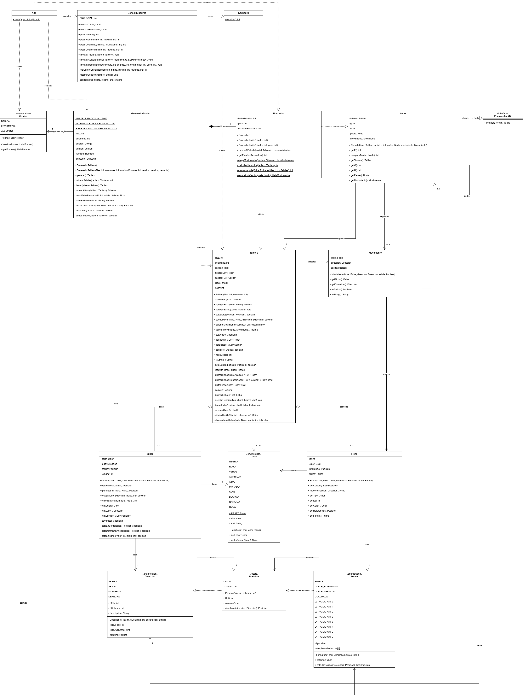

# Cuadros de Colores

Solución en Java del proyecto de cuadros de colores de la materia de Tecnologías de Programación. En este documento se describe cómo se resuelve el problema, qué algoritmo se usa y cómo está organizado el programa. Las tres versiones (básica, intermedia y avanzada) están implementadas. La solución es la mínima en todas las versiones, salvo en los tableros de la versión avanzada de más de 64 casillas, donde se usa A* ponderado y el programa indica qué tan cerca está la solución del mínimo (ver la sección de estado al final).

El juego consiste en un tablero con fichas de colores que se pueden mover arriba, abajo, izquierda o derecha si el lugar al que se mueven está libre. En las orillas hay salidas de colores por donde las fichas pueden salir si son del mismo color. Se busca encontrar la secuencia de movimientos que saca todas las fichas usando el menor número de movimientos posible, e imprimir el tablero después de cada movimiento.

El enunciado pide tres versiones (básica, intermedia y avanzada) que cambian el tamaño del tablero y la forma de las fichas. Por eso se busca que el algoritmo de búsqueda no dependa de la forma de las fichas, y que pasar de una versión a otra solo implique agregar nuevos tipos de ficha.

## Ejecución

Se requiere Java 16 o superior, ya que el proyecto utiliza `record`. El proyecto no depende de ningún IDE ni de bibliotecas externas. Para compilarlo y ejecutarlo desde una terminal, en la raíz del proyecto:

```
javac -encoding UTF-8 -d bin src/*.java
java -cp bin App
```

## Versiones del juego

| Versión | Tablero | Colores | Fichas | Salidas |
|---|---|---|---|---|
| Básica (constructor sin parámetros) | 2x2 | 2 | Tamaño 1 | 2, una de tamaño 1 por color |
| Intermedia | NxN, con N mayor a 2 y menor a 8 | 3 a 10 | Tamaño 1 y tamaño 2 (horizontal o vertical) | De una casilla; apropiadas para fichas horizontales o verticales |
| Avanzada | NxM, con N y M mayores a 4 y menores a 15 | 3 a 10 | Tamaño 1, tamaño 2, tamaño 3 o 4 en forma de L (todas las rotaciones) y 2x2 | De una o dos casillas; apropiadas para fichas horizontales o verticales |

Las fichas de tamaño mayor a 1 se mueven completas, por lo que todas las casillas destino deben estar libres.

En las figuras del enunciado, las salidas de la versión intermedia tienen una sola letra, es decir, son de una casilla. Una ficha doble sale a lo largo: si es horizontal, por una salida de la izquierda o la derecha; si es vertical, por una de arriba o abajo. En la versión avanzada aparecen salidas de dos casillas (letras dobles), necesarias para las fichas 2x2 y algunas fichas en L.

## Flujo del juego

1. Se colocan las salidas, una por color, en posiciones al azar del borde.
2. Se llena el tablero con fichas de colores al azar, como en las figuras del enunciado. Los colores no necesariamente están distribuidos de forma uniforme. Al menos una ficha queda junto a una salida de su color: como el tablero empieza lleno, ninguna ficha se puede mover al inicio, así que el primer movimiento siempre es sacar una ficha, y eso deja la primera casilla vacía.
3. Se busca la lista de movimientos válidos que saca todas las fichas con el mínimo número de movimientos (en la versión avanzada con más de 64 casillas, una solución aproximada; ver A* ponderado).
4. Se imprime el tablero después de cada movimiento, y al final el número de movimientos, los estados que revisó la búsqueda y si la solución es la mínima.

El enunciado pide que siempre haya solución. Para garantizarlo, el tablero se arma jugando al revés: se empieza con el tablero vacío y se repite al azar meter una ficha por una salida de su color o mover una ficha, hasta llenarlo. Cada uno de esos pasos se puede deshacer (sacar la ficha o regresar el movimiento), así que el tablero final siempre tiene solución. Los detalles están en la sección de GeneradorTablero.

## El juego como problema de búsqueda

Cada forma en que puede estar acomodado el tablero es un estado, y cada movimiento válido lleva de un estado a otro. Todos los estados juntos forman un grafo donde los nodos son los tableros y las aristas son los movimientos. Como cada movimiento cuesta 1, encontrar la solución con menos movimientos es lo mismo que encontrar el camino más corto en ese grafo.

- **Estado:** las fichas que siguen en el tablero y la posición de cada una (color, forma y orientación). Las salidas no cambian durante el juego, por lo que no forman parte del estado.
- **Estado inicial:** el tablero generado al azar.
- **Estado meta:** el tablero vacío.
- **Acciones:** mover una ficha una casilla en alguna de las cuatro direcciones si las casillas destino están libres, o sacar una ficha que está junto a una salida de su color y compatible con su forma.
- **Costo:** cada acción cuesta 1, así que el costo de un camino es su número de movimientos.

## Propuesta de solución

### Algoritmo A*

Para buscar el camino más corto se propone usar el algoritmo A*. Este algoritmo no explora los estados a ciegas, sino que en cada paso escoge el estado que parece más prometedor. Para eso, a cada estado n se le calcula:

```
f(n) = g(n) + h(n)
```

- **g(n):** número de movimientos realizados desde el tablero inicial hasta llegar a n.
- **h(n):** estimación de cuántos movimientos faltan para vaciar el tablero desde n (la heurística).
- **f(n):** estimación del total de movimientos de la mejor solución que pasa por n.

El algoritmo trabaja con dos listas:

- **Lista abierta:** estados que ya se generaron pero que todavía no se revisan. Siempre se saca de aquí el estado con la f más chica.
- **Lista cerrada:** tableros que ya se revisaron, para no procesarlos otra vez. En este juego es muy común regresar a un tablero ya visto, por ejemplo al mover una ficha a la derecha y después a la izquierda.

Si la heurística nunca se pasa del número real de movimientos que faltan (es admisible), A* siempre encuentra la solución óptima, que es lo que pide el proyecto. Si además es consistente, no hace falta volver a abrir estados que ya están en la lista cerrada. Otra ventaja es que A* no depende de la forma de las fichas: solo necesita saber qué movimientos son válidos y cuánto vale la heurística, por lo que el mismo algoritmo serviría para las tres versiones.

### Alternativas consideradas

También se consideró la búsqueda en anchura (BFS), que da la solución óptima porque todos los movimientos cuestan lo mismo. El problema es que revisa todos los estados nivel por nivel sin ninguna guía, y en tableros grandes son demasiados. Por eso BFS no forma parte del programa final: se implementó solo durante el desarrollo, como herramienta de verificación en tableros chicos, para comprobar que A* da el mismo número de movimientos y para ver cuántos estados se ahorran con la heurística (ver los resultados de las pruebas).

También se consideró IDA*, que usa mucha menos memoria que A* y sigue dando la solución óptima. No se usó porque revisa los mismos estados que A* o más, y en los tableros grandes el problema resultó ser el tiempo, no la memoria.

### Salir en cuanto se pueda

Si en un tablero alguna ficha puede salir, A* solo considera ese movimiento y no los demás. Esto no empeora la solución: sacar una ficha que ya puede salir solo deja más espacio libre, así que cualquier secuencia de movimientos que se pudiera hacer con la ficha en el tablero se puede hacer también sin ella, y la ficha tendría que salir en algún momento de todos modos. En cambio, reduce mucho los tableros que hay que revisar, sobre todo al principio, cuando el tablero está lleno. En las pruebas, A* con esta regla dio siempre el mismo número de movimientos que la búsqueda en anchura.

### A* ponderado y cota inferior

En la versión avanzada, con tableros de más de 64 casillas (más grandes que 8x8), A* con la solución mínima garantizada no terminaba en un tiempo razonable. Para esos tableros se usa A* ponderado: la heurística se multiplica por un peso w (en el programa, w = 2), es decir, f(n) = g(n) + w·h(n). Con eso A* confía más en la heurística, avanza más directo hacia la meta y revisa muchos menos estados. A cambio, la solución ya no es necesariamente la mínima, pero tiene una garantía: nunca tiene más de w veces el mínimo de movimientos.

Para saber qué tan cerca quedó del mínimo se usa la cota inferior: el valor de la heurística en el tablero inicial, sin multiplicar. Como la heurística es admisible, ninguna solución puede tener menos movimientos que ese valor. El programa compara la solución con la cota:

- Si son iguales, la solución es la mínima, aunque se haya encontrado con A* ponderado.
- Si no, se indica como aproximada y se muestra la cota, así que se sabe cuántos movimientos podrían sobrar como máximo.

En las pruebas con tableros de 9x9 a 14x14, las soluciones quedaron a lo más 7% por encima de la cota inferior, mucho mejor que la garantía teórica del doble.

En los demás tableros (versiones básica, intermedia y avanzada hasta 8x8) se usa A* con peso 1, que es A* normal y siempre da la solución mínima.

### Pasos del algoritmo

1. Crear un nodo con el tablero inicial, con g = 0, su h calculada y sin padre. Meterlo a la lista abierta. La lista cerrada empieza vacía.
2. Sacar de la lista abierta el nodo con la f más chica. Si hay empate, se escoge el de menor h porque está más cerca de terminar.
3. Si ese tablero ya no tiene fichas, se encontró la solución y se pasa al paso 8.
4. Si el tablero ya está en la lista cerrada, se ignora y se regresa al paso 2. Esto pasa porque el mismo tablero se puede meter varias veces a la lista abierta por caminos diferentes.
5. Si no, se agrega a la lista cerrada.
6. Generar los movimientos posibles: para cada ficha se prueba moverla arriba, abajo, izquierda y derecha, y se revisa si puede salir. Cada movimiento válido da un tablero nuevo.
7. A cada tablero nuevo que no esté en la lista cerrada se le calcula g (la g del padre más 1), h y f, se le guarda su padre y el movimiento que se hizo, y se mete a la lista abierta. Luego se regresa al paso 2.
8. Al llegar al tablero vacío se siguen los padres hacia atrás hasta el tablero inicial. Eso da los movimientos al revés; se voltean y se imprimen en orden, mostrando el tablero después de cada movimiento.

Si la lista abierta se queda vacía sin llegar al tablero vacío, ese tablero no tiene solución.

### Pseudocódigo

```
BUSCAR_A_ESTRELLA(inicial)
    abiertos = cola de prioridad ordenada por f (empate: menor h)
    cerrados = conjunto vacio
    inicial.g = 0
    inicial.h = CALCULAR_HEURISTICA(inicial)
    inicial.padre = nulo
    meter inicial en abiertos

    mientras abiertos no este vacia
        n = sacar de abiertos el de menor f
        si n no tiene fichas
            regresar RECONSTRUIR_CAMINO(n)
        si n.tablero esta en cerrados
            continuar
        meter n.tablero en cerrados
        para cada movimiento m en OBTENER_MOVIMIENTOS_VALIDOS(n)
            s = aplicar m a n
            si s.tablero no esta en cerrados
                s.g = n.g + 1
                s.h = CALCULAR_HEURISTICA(s)
                s.padre = n
                s.movimiento = m
                meter s en abiertos
    regresar "sin solucion"

CALCULAR_HEURISTICA(n)
    h = 0
    para cada ficha f en n
        d = infinito
        para cada salida s del color de f por la que f cabe
            dist = movimientos laterales para que f quede dentro del ancho de s
                   + movimientos para que la casilla de f mas cercana llegue al borde de s
            si dist < d entonces d = dist
        h = h + d + 1
    regresar h

OBTENER_MOVIMIENTOS_VALIDOS(n)
    lista = vacia
    para cada ficha f que esta junto a una casilla vacia
        para cada direccion en arriba, abajo, izquierda, derecha
            si las casillas destino de f estan libres
                agregar Mover(f, direccion) a lista
    para cada salida s
        para cada ficha f que ocupa una casilla de s
            si s permite salir a f
                agregar Salir(f) a lista
    regresar lista

RECONSTRUIR_CAMINO(n)
    camino = lista vacia
    mientras n.padre no sea nulo
        agregar n.movimiento al inicio de camino
        n = n.padre
    regresar camino
```

## La heurística

La heurística calcula, para cada ficha, cuántos movimientos le faltarían para salir si no hubiera otras fichas estorbando, y suma lo de todas las fichas:

```
h(n) = suma de (distancia + 1) de todas las fichas del tablero
```

La distancia es la distancia Manhattan entre la ficha y la salida más cercana de su color, y el 1 es el movimiento de salir. La distancia Manhattan entre dos casillas se calcula como abs(fila1 - fila2) + abs(col1 - col2), es decir, las casillas que hay que avanzar en vertical más las que hay que avanzar en horizontal. Se usa porque las fichas no se mueven en diagonal.

La casilla contra la que se mide es la casilla del borde pegada a la salida (N es el número de filas y M el de columnas):

| Posición de la salida | Casilla de salida |
|---|---|
| Arriba, columna c | (0, c) |
| Abajo, columna c | (N - 1, c) |
| Izquierda, fila r | (r, 0) |
| Derecha, fila r | (r, M - 1) |

El cálculo se haría así:

1. Empezar con h = 0.
2. Para cada ficha, buscar las salidas de su color por las que cabe, es decir, que no sean más angostas que la ficha vista a lo largo del borde.
3. Calcular la distancia de la ficha a cada una de esas salidas y quedarse con la menor.
4. Sumar esa distancia más 1 a h.
5. Al terminar con todas las fichas, el valor acumulado es h.

### Fichas de más de una casilla

En una primera versión se pensó medir desde la casilla de referencia de la ficha (la de arriba a la izquierda). Al probarlo con fichas dobles resultó que no es admisible: una ficha doble vertical lista para salir por abajo tiene su referencia una fila arriba del borde, así que la heurística contaba un movimiento de más. En pruebas con 528 tableros al azar de 3x3 y 4x4 con fichas simples y dobles, A* dio una solución más larga que la mínima en 87 de ellos.

Por eso la distancia se calcula para la ficha completa, como la suma de dos partes:

- **Movimientos laterales:** cuánto hay que recorrer la ficha a lo largo del borde para que todas sus casillas queden dentro del ancho de la salida. Si ya caben, es 0.
- **Movimientos hacia el borde:** cuánto le falta a la casilla de la ficha más cercana al borde para llegar a él.

Un movimiento mueve todas las casillas de la ficha una posición en una sola dirección, así que reduce una de las dos partes en 1 como máximo, nunca las dos. Si la ficha es más ancha que la salida, esa salida no se considera. Con una ficha simple y una salida de una casilla, el resultado es exactamente la distancia Manhattan. Con este cálculo, A* dio la solución mínima en los 528 tableros de la prueba.

Este cálculo está en el método `calcularDistancia` de Salida, porque es la clase que conoce el lado, la posición y el ancho de la salida.

### Cálculo incremental

Un movimiento solo cambia una ficha, así que la heurística de un tablero nuevo no se recalcula completa. Se obtiene a partir de la del tablero anterior: se resta el aporte de la ficha en su posición anterior y, si no salió, se suma su aporte en la posición nueva. Con 100 fichas, esto es unas 100 veces menos trabajo en la heurística. Da exactamente el mismo valor que recalcularla: en las pruebas, A* revisó los mismos estados con los dos cálculos.

### Ejemplo

Tablero de 4x4 con una ficha roja en (2,1) y una azul en (1,1), dos salidas rojas (derecha de la fila 0 y abajo de la columna 1) y una salida azul arriba de la columna 3.

```
              Salida A
+---+---+---+---+
|   |   |   |   |  Salida R
+---+---+---+---+
|   | A |   |   |
+---+---+---+---+
|   | R |   |   |
+---+---+---+---+
|   |   |   |   |
+---+---+---+---+
      Salida R
```

| Ficha | Salida | Casilla | Distancia | Aporte |
|---|---|---|---|---|
| R (2,1) | Derecha fila 0 | (0,3) | abs(2-0) + abs(1-3) = 4 | - |
| R (2,1) | Abajo columna 1 | (3,1) | abs(2-3) + abs(1-1) = 1 | 1 + 1 = 2 |
| A (1,1) | Arriba columna 3 | (0,3) | abs(1-0) + abs(1-3) = 3 | 3 + 1 = 4 |
| | | | **Total h** | **6** |

Para la ficha roja se toma la salida de abajo porque está más cerca. El resultado h = 6 significa que se necesitan por lo menos 6 movimientos para vaciar ese tablero.

### Por qué es admisible

- Cada movimiento solo mueve una ficha; las demás no cambian y su parte de la suma queda igual.
- Si la ficha se mueve una casilla, su distancia cambia como mucho en 1, también en fichas de varias casillas, como se explica arriba.
- Si la ficha sale, se quita de la suma un valor de exactamente 1.
- Entonces con cada movimiento h baja como mucho 1, que es lo que cuesta el movimiento, o sea que h(n) es menor o igual que 1 + h del siguiente estado (es consistente). Como en el tablero vacío h vale 0, nunca se pasa de los movimientos que realmente faltan.

Lo que no toma en cuenta son los bloqueos entre fichas. Sin embargo, al medir el valor de la heurística del tablero inicial contra la solución mínima real en tableros que A* resolvió, resultaron iguales en casi todos los casos: en los tableros que arma el generador, cada ficha puede llegar a su salida casi sin estorbarse con las demás. Una heurística más fuerte solo ayudaría en los tableros difíciles (ver trabajo futuro).

## Ejemplo a mano con la versión de 2x2

Tablero de 2x2 con fichas negras (N) y una roja (R). La salida negra está arriba de la casilla (0,0) y la salida roja abajo de la casilla (1,1).

```
 Salida N
+---+---+
| R | N |
+---+---+
| N |   |
+---+---+
     Salida R
```

Heurística del tablero inicial:

| Ficha | Casilla de salida | Distancia | Aporte |
|---|---|---|---|
| R en (0,0) | (1,1) | 2 | 3 |
| N en (0,1) | (0,0) | 1 | 2 |
| N en (1,0) | (0,0) | 1 | 2 |
| | | **Total h** | **7** |

Entonces g = 0, h = 7 y f = 7. Desde ahí ninguna ficha puede salir y la única casilla libre es (1,1), así que solo hay dos movimientos: bajar la negra de (0,1) o mover a la derecha la negra de (1,0). En los dos casos la ficha queda en (1,1), a distancia 2 de su salida, y los dos tableros quedan con g = 1, h = 8 y f = 9. Como la heurística es consistente, f nunca baja a lo largo de un camino, así que la solución no puede tener menos de 9 movimientos.

Primeras iteraciones del algoritmo:

| Iteración | Nodo que se saca | Nuevos nodos (g, h, f) | Lista abierta |
|---|---|---|---|
| 1 | Inicial (0, 7, 7) | A: bajar N de (0,1) (1, 8, 9); B: N de (1,0) a la derecha (1, 8, 9) | A, B |
| 2 | B (1, 8, 9) | C: bajar R (2, 7, 9). Regresar N da el inicial, que ya está cerrado | A, C |
| 3 | C (2, 7, 9), menor h | D: N de (0,1) a la izquierda (3, 6, 9) | A, D |
| 4 | D (3, 6, 9) | E: sale N de (0,0) (4, 5, 9); E2: subir N de (1,1) (4, 5, 9) | A, E, E2 |

Camino completo encontrado (la diagonal separa la fila 0 de la fila 1 y el guion es una casilla vacía):

| Paso | Movimiento | Tablero | g | h | f |
|---|---|---|---|---|---|
| 0 | Inicio | `R N / N -` | 0 | 7 | 7 |
| 1 | N(1,0) a la derecha | `R N / - N` | 1 | 8 | 9 |
| 2 | R(0,0) hacia abajo | `- N / R N` | 2 | 7 | 9 |
| 3 | N(0,1) a la izquierda | `N - / R N` | 3 | 6 | 9 |
| 4 | N(0,0) sale | `- - / R N` | 4 | 5 | 9 |
| 5 | N(1,1) hacia arriba | `- N / R -` | 5 | 4 | 9 |
| 6 | R(1,0) a la derecha | `- N / - R` | 6 | 3 | 9 |
| 7 | R(1,1) sale | `- N / - -` | 7 | 2 | 9 |
| 8 | N(0,1) a la izquierda | `N - / - -` | 8 | 1 | 9 |
| 9 | N(0,0) sale | `- - / - -` | 9 | 0 | 9 |

La f se mantiene en 9 todo el camino y la solución tiene 9 movimientos, que es el mínimo calculado al inicio, por lo que la solución es óptima. Cada fila de la tabla corresponde a un tablero que el programa imprimiría en pantalla.

## Implementación en Java

La idea es separar el modelo del juego de la búsqueda. Para la organización de la búsqueda se tomó como referencia el capítulo 2 de *Classic Computer Science Problems in Java* (David Kopec), en particular la clase de nodo y la forma de reconstruir el camino.

Se tienen pensadas las siguientes clases, contando Keyboard, que es la utilería del curso:

| Clase | Contenido |
|---|---|
| Color (enum) | Colores posibles de fichas y salidas, con su letra y su color para la consola |
| Direccion (enum) | ARRIBA, ABAJO, IZQUIERDA, DERECHA, con cuánto cambian la fila y la columna |
| Posicion (record) | Fila y columna de una casilla |
| Ficha | id, color, posición de referencia y forma; calcula sus casillas y se mueve |
| Forma (enum) | Las 12 formas de ficha (simple, dobles, 2x2 y las 8 de L), cada una con las casillas que ocupa |
| Salida | Color, lado del tablero, fila o columna donde está, y tamaño |
| Movimiento | Ficha que se mueve, dirección y si es un movimiento de salida |
| Tablero | Filas, columnas, matriz int[][], lista de fichas y lista de salidas. Valida movimientos y genera los tableros siguientes |
| Nodo | Tablero, g, h, padre y movimiento |
| Buscador | A* (normal o ponderado), con la heurística y la reconstrucción del camino |
| Version (enum) | BASICA, INTERMEDIA, AVANZADA; le indica al generador qué formas de ficha usar |
| GeneradorTablero | Crea tableros llenos al azar que siempre tienen solución |
| ConsolaCuadros | Única clase que lee del teclado e imprime en pantalla |
| Keyboard | Utilería del curso para leer datos del teclado |
| App | Punto de entrada |

Cada versión agrega formas de ficha: las dobles en la intermedia, y la 2x2 y las L en la avanzada. Tablero, Buscador y Salida trabajan con las casillas que regresa `getCeldas()`, así que mover, sacar y medir la distancia de una ficha funciona igual para cualquier forma. Al agregar las fichas de la versión avanzada no hubo que cambiar Buscador, Nodo ni las reglas de salida de Salida. Las formas empezaron como subclases de Ficha y después se pasaron a un enum (ver Forma).

Se consideró tener una clase aparte para la heurística, pero no hace falta: es una sola función y queda dentro de Buscador, apoyada en `calcularDistancia` de Salida. Para las versiones sí se agregó el enum Version, porque el generador necesita saber qué formas de ficha usar, y las tres versiones del enunciado son un conjunto fijo de valores, igual que los colores y las direcciones.

La entrada y salida sí se separó en ConsolaCuadros, porque para las versiones intermedia y avanzada hay que pedir al usuario el tamaño del tablero y el número de colores, y validarlos. Así las demás clases no contienen ningún texto ni leen del teclado, igual que en un proyecto anterior de la materia (Blackjack, con ConsolaBlackjack).

### Diagrama de clases



El archivo editable está en [docs/CuadrosDeColores.drawio](docs/CuadrosDeColores.drawio) y se abre con draw.io. Los miembros estáticos van subrayados. Las relaciones son de asociación (línea continua con flecha abierta), dependencia «create» o «use» (línea punteada), composición (rombo relleno, de GeneradorTablero a Buscador) y agregación (rombo vacío, de Tablero a Ficha y a Salida).

### Atributos y métodos

Los atributos y métodos de cada clase son los siguientes. En los constructores la columna de retorno queda vacía.

Casi todos los atributos son `private final`, porque las fichas, posiciones, salidas y movimientos no cambian una vez creados: mover una ficha o aplicar un movimiento regresa un objeto nuevo. Se accede a ellos solo por medio de sus métodos get.

#### Color (enum)

Cada constante (`NEGRO`, `ROJO`, `AZUL`, etc.) es implícitamente `public static final Color`.

| Atributo | Acceso | Tipo | Descripción |
|---|---|---|---|
| `letra` | private final | `char` | Letra con la que se identifica el color en consola |
| `ansi` | private final | `String` | Código ANSI que pinta el fondo de ese color |
| `RESET` | public static final | `String` | Código ANSI que regresa la consola a su color normal; es igual para todos los colores, por eso es static |

| Método | Acceso | Retorno | Descripción |
|---|---|---|---|
| `Color(char letra, String ansi)` | private | | Constructor de cada constante; en un enum siempre es privado |
| `getLetra()` | public | `char` | Letra del color |
| `pintar(String texto)` | public | `String` | Regresa el texto con el color aplicado y el RESET al final |

#### Direccion (enum)

Constantes: `ARRIBA`, `ABAJO`, `IZQUIERDA`, `DERECHA`. La fila 0 es la de arriba, por lo que ARRIBA resta 1 a la fila y ABAJO le suma 1.

| Atributo | Acceso | Tipo | Descripción |
|---|---|---|---|
| `dFila` | private final | `int` | Cuánto cambia la fila: -1, 0 o 1 |
| `dColumna` | private final | `int` | Cuánto cambia la columna: -1, 0 o 1 |
| `descripcion` | private final | `String` | Texto con el que se imprime la dirección, por ejemplo `hacia la derecha` |

| Método | Acceso | Retorno | Descripción |
|---|---|---|---|
| `Direccion(int dFila, int dColumna, String descripcion)` | private | | Constructor de cada constante |
| `getDFila()` | public | `int` | Cuánto cambia la fila al moverse en esa dirección |
| `getDColumna()` | public | `int` | Cuánto cambia la columna al moverse en esa dirección |
| `toString()` | public | `String` | Regresa la descripción, para que los movimientos se impriman en español |

#### Posicion (record)

Se declara como record para que sea inmutable y ya traiga equals() y hashCode(). Un record es `final` de forma implícita, así que no se puede heredar de él.

| Atributo | Acceso | Tipo | Descripción |
|---|---|---|---|
| `fila` | private final | `int` | Fila de la casilla; el record la declara así automáticamente |
| `columna` | private final | `int` | Columna de la casilla; el record la declara así automáticamente |

| Método | Acceso | Retorno | Descripción |
|---|---|---|---|
| `Posicion(int fila, int columna)` | public | | Constructor generado por el record |
| `fila()`, `columna()` | public | `int` | Accesores generados por el record |
| `desplazar(Direccion d)` | public | `Posicion` | Regresa una nueva posición, la vecina en esa dirección |

#### Ficha (final)

Una sola clase para todas las fichas. Lo que distingue a una ficha simple de una doble, una cuadrada o una L es su forma, que es un dato (atributo `forma`, del enum Forma), no una subclase. La ficha le pide a su forma qué casillas ocupa a partir de su referencia. Se declara `final` porque ninguna clase hereda de ella.

| Atributo | Acceso | Tipo | Descripción |
|---|---|---|---|
| `id` | private final | `int` | Identificador de la ficha; es el número que se guarda en la matriz del tablero |
| `color` | private final | `Color` | Color de la ficha |
| `referencia` | private final | `Posicion` | Esquina de arriba a la izquierda del rectángulo que ocupa la ficha |
| `forma` | private final | `Forma` | Forma de la ficha |

| Método | Acceso | Retorno | Descripción |
|---|---|---|---|
| `Ficha(int id, Color color, Posicion referencia, Forma forma)` | public | | Crea la ficha |
| `getCeldas()` | public | `List<Posicion>` | Casillas que ocupa: las que calcula su forma a partir de la referencia |
| `mover(Direccion direccion)` | public | `Ficha` | Regresa una nueva ficha con la misma forma, desplazada una casilla |
| `getTipo()` | public | `char` | Letra que identifica la forma, la de su Forma |
| `getId()` | public | `int` | Id de la ficha |
| `getColor()` | public | `Color` | Color de la ficha |
| `getReferencia()` | public | `Posicion` | Casilla de referencia |
| `getForma()` | public | `Forma` | Forma de la ficha |

#### Forma (enum)

Las 12 formas de ficha que pide el enunciado: `SIMPLE`, `DOBLE_HORIZONTAL`, `DOBLE_VERTICAL`, `CUADRADA` (2x2), las 4 rotaciones de la L de 3 (`L3_ROTACION_0` a `L3_ROTACION_3`) y las 4 de la L de 4 (`L4_ROTACION_0` a `L4_ROTACION_3`). Cada rotación es la anterior girada 90 grados a la derecha.

Cada constante guarda una tabla de desplazamientos {fila, columna} de sus casillas respecto a la referencia, y una letra de tipo distinta. La letra es distinta para cada forma para que la clave del tablero distinga, por ejemplo, una ficha doble horizontal de una vertical o de dos fichas simples del mismo color.

En algunas rotaciones de la L, la casilla de referencia (la esquina del rectángulo) no forma parte de la ficha. Por eso Movimiento muestra la primera casilla real de la ficha y no la referencia.

| Atributo | Acceso | Tipo | Descripción |
|---|---|---|---|
| `tipo` | private final | `char` | Letra de la forma: `S`, `H`, `V`, `C`, de `a` a `d` para la L de 3 y de `e` a `h` para la L de 4 |
| `desplazamientos` | private final | `int[][]` | Desplazamiento {fila, columna} de cada casilla respecto a la referencia |

| Método | Acceso | Retorno | Descripción |
|---|---|---|---|
| `Forma(char tipo, int[][] desplazamientos)` | private | | Constructor de cada constante |
| `getTipo()` | public | `char` | Letra de la forma |
| `calcularCasillas(Posicion referencia)` | public | `List<Posicion>` | Suma a la referencia cada desplazamiento y regresa las casillas que ocupa la forma |

**Por qué un enum y no subclases de Ficha.** En una primera versión cada forma era una subclase de Ficha (FichaSimple, FichaDoble, FichaCuadrada y FichaL). Funcionaba, pero las formas no tienen comportamiento distinto, solo casillas distintas: las cuatro subclases hacían lo mismo con otros datos. Como enum, las formas son un conjunto fijo de valores, igual que los colores y las direcciones; se elimina el número mágico que antes identificaba cada forma en el generador; y cada versión declara qué formas permite en un solo lugar (ver Version). El cambio se verificó comprobando que, en los mismos tableros, A* revisara exactamente los mismos estados que antes.

#### Salida

La salida guarda directamente su casilla de salida, que calcula el generador porque es quien conoce el tamaño del tablero. Así la salida no necesita saber cuántas filas y columnas hay.

La casilla guardada es la primera de la salida: la de más a la izquierda en salidas de arriba o abajo, y la de más arriba en salidas de izquierda o derecha. A partir de ella, la salida abarca `tamano` casillas a lo largo del borde.

Una ficha puede salir cuando es del color de la salida, alguna de sus casillas toca el borde de la salida y todas sus casillas, vistas a lo largo del borde, caben dentro del ancho de la salida. Así el mismo método sirve para fichas de una casilla, dobles, en L y 2x2.

| Atributo | Acceso | Tipo | Descripción |
|---|---|---|---|
| `color` | private final | `Color` | Color de las fichas que pueden salir |
| `lado` | private final | `Direccion` | Lado del tablero donde está la salida |
| `casilla` | private final | `Posicion` | Primera casilla del borde pegada a la salida |
| `tamano` | private final | `int` | Número de casillas que abarca la salida; en las versiones básica e intermedia siempre es 1, y en la avanzada puede ser 1 o 2 |

| Método | Acceso | Retorno | Descripción |
|---|---|---|---|
| `Salida(Color color, Direccion lado, Posicion casilla, int tamano)` | public | | Crea la salida |
| `getPrimeraCasilla()` | public | `Posicion` | Primera casilla del borde pegada a la salida |
| `getCasillas()` | public | `List<Posicion>` | Todas las casillas que abarca la salida (1 o 2); Tablero las usa para saber qué fichas pueden salir y el generador para que dos salidas no se encimen |
| `permiteSalir(Ficha ficha)` | public | `boolean` | Verifica que la ficha sea de su color, que toque el borde de la salida y que quepa por ella |
| `ocupa(Direccion lado, int indice)` | public | `boolean` | Verifica si la salida está en ese lado y abarca esa fila o columna; Tablero lo usa para dibujar las salidas |
| `calcularDistancia(Ficha ficha)` | public | `int` | Movimientos que le faltan a la ficha para quedar lista para salir: los laterales para caber en el ancho más los necesarios para llegar al borde. Regresa `Integer.MAX_VALUE` si la ficha es de otro color o más ancha que la salida |
| `getColor()` | public | `Color` | Color de la salida |
| `getLado()` | public | `Direccion` | Lado del tablero donde está |
| `esVertical()` | private | `boolean` | Verdadero si la salida está arriba o abajo del tablero |
| `estaEnBorde(Posicion celda)` | private | `boolean` | Verifica que la casilla esté en la fila o columna pegada a la salida |
| `estaDentroDelAncho(Posicion celda)` | private | `boolean` | Verifica que la casilla quede dentro de las casillas que abarca la salida |
| `estaEnRango(int valor, int inicio)` | private | `boolean` | Verifica que el valor esté entre `inicio` e `inicio + tamano - 1` |

#### Movimiento

| Atributo | Acceso | Tipo | Descripción |
|---|---|---|---|
| `ficha` | private final | `Ficha` | Ficha que se mueve, tal como estaba antes del movimiento |
| `direccion` | private final | `Direccion` | Dirección del movimiento; en una salida, el lado por donde sale |
| `salida` | private final | `boolean` | Verdadero si la ficha sale del tablero |

| Método | Acceso | Retorno | Descripción |
|---|---|---|---|
| `Movimiento(Ficha ficha, Direccion direccion, boolean salida)` | public | | Crea el movimiento |
| `getFicha()` | public | `Ficha` | Ficha que se mueve |
| `getDireccion()` | public | `Direccion` | Dirección del movimiento |
| `esSalida()` | public | `boolean` | Verdadero si la ficha sale del tablero |
| `toString()` | public | `String` | Letra del color y primera casilla de la ficha antes del movimiento, seguidas de "se mueve" con la dirección, o de "sale"; por ejemplo `N(1,0) se mueve hacia la derecha` o `R(1,1) sale` |

#### Tablero

Los atributos son `final`, pero eso solo impide cambiar la referencia: el contenido de la matriz y de las listas sí cambia mientras el generador agrega fichas y salidas. Una vez armado, el tablero ya no se modifica; `aplicar` trabaja sobre una copia.

La clave que usan equals() y hashCode() describe cada casilla con tres caracteres: la letra del color de su ficha, la letra de su tipo y el número de esa casilla dentro de la ficha (su posición en `getCeldas()`). Ese número es necesario por las fichas en L: sin él, dos acomodos distintos de fichas en L podrían dar la misma clave, y A* confundiría dos tableros diferentes. Como no usa el id de la ficha, dos fichas iguales del mismo color siguen contando como intercambiables.

La clave se guarda como arreglo de caracteres junto con su hash. No se arma desde cero en cada tablero: cuando `aplicar` crea un tablero nuevo, copia la clave del tablero anterior y solo borra y vuelve a escribir las casillas de la ficha que se movió. `equals` compara primero los hash y solo si coinciden compara la clave completa, así que es rápido y nunca confunde dos tableros distintos.

Las copias del tablero comparten la lista de salidas en lugar de copiarla, porque las salidas nunca cambian durante la búsqueda.

| Atributo | Acceso | Tipo | Descripción |
|---|---|---|---|
| `filas` | private final | `int` | Número de filas (N) |
| `columnas` | private final | `int` | Número de columnas (M) |
| `casillas` | private final | `int[][]` | Id de la ficha que ocupa cada casilla, o 0 si está vacía |
| `fichas` | private final | `List<Ficha>` | Fichas que siguen en el tablero |
| `salidas` | private final | `List<Salida>` | Salidas del tablero; las copias del tablero comparten la misma lista |
| `clave` | private | `char[]` | Clave del tablero, o null si hay que calcularla; no es final porque se borra al agregar o quitar fichas |
| `hash` | private | `int` | Hash de la clave, calculado una sola vez junto con ella |

| Método | Acceso | Retorno | Descripción |
|---|---|---|---|
| `Tablero(int filas, int columnas)` | public | | Crea un tablero vacío |
| `Tablero(Tablero original)` | private | | Copia otro tablero: copia la matriz, crea la lista de fichas ya con su tamaño y comparte la lista de salidas |
| `agregarFicha(Ficha ficha)` | public | `boolean` | Coloca la ficha si sus casillas están libres; regresa si se pudo |
| `agregarSalida(Salida salida)` | public | `void` | Agrega una salida |
| `estaLibre(Posicion posicion)` | public | `boolean` | Verifica que la casilla esté dentro del tablero y vacía |
| `puedeMover(Ficha ficha, Direccion direccion)` | public | `boolean` | Verifica que las casillas a donde llegaría la ficha estén dentro del tablero y libres, o que sean de la misma ficha |
| `obtenerMovimientosValidos()` | public | `List<Movimiento>` | Todos los movimientos posibles. Solo prueba mover las fichas que están junto a una casilla vacía, que son las únicas que pueden moverse, y para cada salida solo las fichas que ocupan sus casillas |
| `aplicar(Movimiento movimiento)` | public | `Tablero` | Regresa un tablero nuevo con el movimiento hecho, con su clave armada a partir de la del tablero original; el original no cambia |
| `estaVacio()` | public | `boolean` | Verdadero cuando ya no quedan fichas |
| `getFichas()` | public | `List<Ficha>` | Fichas que siguen en el tablero, en una lista de solo lectura |
| `getSalidas()` | public | `List<Salida>` | Salidas del tablero, en una lista de solo lectura |
| `equals(Object o)` | public | `boolean` | Compara primero los hash y, si coinciden, la clave completa |
| `hashCode()` | public | `int` | Regresa el hash guardado de la clave |
| `toString()` | public | `String` | Dibujo del tablero con sus salidas y colores |
| `estaDentro(Posicion posicion)` | private | `boolean` | Verifica que la posición no se salga del tablero |
| `indexarFichasPorId()` | private | `Ficha[]` | Arreglo donde la posición `id` guarda la ficha con ese id, para encontrar fichas sin recorrer la lista |
| `buscarFichasJuntoAVacias()` | private | `List<Ficha>` | Fichas que están junto a alguna casilla vacía, sin repetir |
| `buscarFichasEn(List<Posicion> posiciones)` | private | `List<Ficha>` | Fichas que ocupan esas casillas, sin repetir |
| `quitarFicha(Ficha ficha)` | private | `void` | Libera las casillas de la ficha y la quita de la lista |
| `copiar()` | private | `Tablero` | Copia del tablero, que usa `aplicar` para no modificar el original |
| `buscarFicha(int id)` | private | `Ficha` | Ficha con ese id, o null si no hay (casilla vacía); solo se usa al dibujar el tablero |
| `escribirFicha(char[] codigo, Ficha ficha)` | private | `void` | Escribe en la clave las tres letras de cada casilla de la ficha |
| `borrarFicha(char[] codigo, Ficha ficha)` | private | `void` | Deja `...` en las casillas de la ficha dentro de la clave |
| `generarClave()` | private | `char[]` | Arma la clave completa y su hash si todavía no existen; si ya estaban calculados, regresa la clave guardada |
| `dibujarCasilla(int fila, int columna)` | private | `String` | Casilla pintada de su color con su letra, o ` . ` si está vacía |
| `obtenerLetraSalida(Direccion lado, int indice)` | private | `char` | Letra de la salida que ocupa esa posición del borde, o un espacio si no hay |

No hay un método `puedeSalir`: `obtenerMovimientosValidos` recorre las salidas directamente, porque necesita saber por cuál sale la ficha para guardar su lado en el Movimiento.

#### Nodo

Implementa `Comparable<Nodo>` para que la cola de prioridad lo ordene por f y, en empate, por h. No guarda f como atributo porque se calcula con g + h.

| Atributo | Acceso | Tipo | Descripción |
|---|---|---|---|
| `tablero` | private final | `Tablero` | Estado del juego en este nodo |
| `g` | private final | `int` | Movimientos desde el tablero inicial |
| `h` | private final | `int` | Valor de la heurística, ya multiplicado por el peso del buscador |
| `padre` | private final | `Nodo` | Nodo anterior en el camino; es null en el nodo inicial |
| `movimiento` | private final | `Movimiento` | Movimiento que llevó del padre a este nodo; es null en el nodo inicial |

| Método | Acceso | Retorno | Descripción |
|---|---|---|---|
| `Nodo(Tablero tablero, int g, int h, Nodo padre, Movimiento movimiento)` | public | | Crea el nodo |
| `getF()` | public | `int` | Regresa g + h |
| `compareTo(Nodo otro)` | public | `int` | Compara por f y, en empate, por h |
| `getTablero()` | public | `Tablero` | Tablero del nodo |
| `getG()` | public | `int` | Movimientos desde el tablero inicial |
| `getH()` | public | `int` | Valor de la heurística |
| `getPadre()` | public | `Nodo` | Nodo anterior en el camino |
| `getMovimiento()` | public | `Movimiento` | Movimiento que llevó a este nodo |

#### Buscador

La lista abierta y la lista cerrada no son atributos sino variables locales de `buscarAEstrella`, para que cada búsqueda empiece desde cero. `calcularHeuristica`, `calcularAporte`, `reconstruirCamino` y `elegirMovimientos` son `static` porque no usan ningún atributo del buscador: solo dependen de lo que reciben.

El buscador puede tener un límite de estados. Si A* revisa ese número de estados sin llegar al tablero vacío, se detiene y regresa una lista vacía. El límite no cambia la solución: si A* llega a la meta antes del límite, esa solución es la óptima; si no llega, no regresa ninguna. App usa un buscador sin límite; el límite solo lo usa el generador para decidir si acepta un tablero.

El buscador también tiene un peso para la heurística. Con peso 1 es A* normal; con peso 2 es A* ponderado. El nodo guarda la h ya multiplicada; al calcular la h de los tableros siguientes se divide entre el peso para recuperar la original, lo cual es exacto porque siempre se guardó como peso por h.

| Atributo | Acceso | Tipo | Descripción |
|---|---|---|---|
| `limiteEstados` | private final | `int` | Máximo de estados que puede revisar A* antes de rendirse |
| `peso` | private final | `int` | Peso de la heurística: 1 para A* normal, 2 para A* ponderado |
| `estadosRevisados` | private | `int` | Estados que sacó de la lista abierta la última búsqueda; no es final porque cambia en cada búsqueda |

| Método | Acceso | Retorno | Descripción |
|---|---|---|---|
| `Buscador()` | public | | Buscador sin límite y con peso 1 |
| `Buscador(int limiteEstados)` | public | | Buscador con límite de estados y peso 1 |
| `Buscador(int limiteEstados, int peso)` | public | | Buscador con límite y peso; los otros dos constructores llaman a este |
| `buscarAEstrella(Tablero inicial)` | public | `List<Movimiento>` | Movimientos de la solución (la óptima con peso 1), o una lista vacía si no hay solución o si se alcanzó el límite. La h de cada tablero nuevo se calcula de forma incremental a partir de la del tablero anterior |
| `getEstadosRevisados()` | public | `int` | Cuántos estados revisó la última búsqueda |
| `calcularHeuristica(Tablero tablero)` | public static | `int` | Suma el aporte de todas las fichas. Es pública porque App la usa para obtener la cota inferior del tablero inicial |
| `calcularAporte(Ficha ficha, List<Salida> salidas)` | private static | `int` | Aporte de una ficha a la heurística: la menor `calcularDistancia` entre todas las salidas más 1, o 0 si ninguna salida le sirve |
| `reconstruirCamino(Nodo meta)` | private static | `List<Movimiento>` | Sigue los padres desde el tablero vacío y regresa los movimientos en orden |
| `elegirMovimientos(Tablero tablero)` | private static | `List<Movimiento>` | Si alguna ficha puede salir, regresa solo ese movimiento; si no, todos los movimientos válidos |

#### Version (enum)

Constantes: `BASICA`, `INTERMEDIA` y `AVANZADA`. Cada una guarda las formas de ficha que permite: la básica solo la simple; la intermedia, la simple y las dos dobles; la avanzada, todas. GeneradorTablero la usa para saber qué formas puede meter y si puede crear salidas de dos casillas; App elige la constante según lo que responde el usuario.

| Atributo | Acceso | Tipo | Descripción |
|---|---|---|---|
| `formas` | private final | `List<Forma>` | Formas de ficha que permite la versión |

| Método | Acceso | Retorno | Descripción |
|---|---|---|---|
| `Version(List<Forma> formas)` | private | | Constructor de cada constante; recibe la lista de formas que permite, armada con `List.of` |
| `getFormas()` | public | `List<Forma>` | Formas de ficha que permite la versión |

#### GeneradorTablero

El tablero se arma jugando al revés:

1. Se pone una salida de cada color en el borde, en un lado y una posición al azar. En la versión avanzada, la mitad de las salidas (al azar) son de dos casillas. Dos salidas nunca comparten casilla.
2. Se mete una ficha simple por cada salida, para que aparezcan todos los colores.
3. Hasta llenar el tablero, se repite al azar una de dos acciones: mover una ficha (cualquier movimiento válido que no sea salir) o meter una ficha nueva por una salida al azar, del color de esa salida.

Para meter una ficha, se revuelven al azar las formas que permite la versión (en la básica solo la simple; en la intermedia también las dobles; en la avanzada también la 2x2 y las 8 formas de L) y se prueban en ese orden. Se usa la primera forma que quepa en alguna posición junto a la salida y que la salida acepte con `permiteSalir`, y se elige al azar una de sus posiciones válidas. Como el orden es al azar, cualquiera de las formas que caben tiene la misma probabilidad de salir. Además, así la ficha entra justo como podría salir: una 2x2 solo entra por salidas de dos casillas.

Cada paso es lo contrario de un movimiento del juego (meter es lo contrario de sacar, y los movimientos se pueden regresar), así que el tablero final siempre tiene solución: basta con deshacer los pasos. Además se cumplen solas las otras reglas del enunciado:

- **Al menos una ficha puede salir:** el último paso siempre es meter una ficha, porque mover no cambia cuántas casillas hay ocupadas, y esa ficha queda junto a su salida.
- **Salidas apropiadas para fichas horizontales o verticales:** cada ficha entra por una salida por la que puede salir, así que todas tienen al menos una salida por la que caben.

Si después de muchos intentos el tablero no se llenó, se descarta y se arma otro.

Que el tablero tenga solución no significa que A* la encuentre rápido. Por eso el generador usa un buscador con un límite de 5,000 estados y se queda con el primer tablero que A* resuelve dentro de ese límite. El buscador del generador usa el mismo peso que va a usar App, para aceptar los tableros que App podrá resolver rápido. Este límite no cambia la calidad de la solución; lo que hace es descartar los tableros que necesitan demasiada búsqueda.

Las fichas no quedan repartidas de forma completamente uniforme: tienden a quedar cerca de las salidas de su color. El enunciado pide que se coloquen al azar y que siempre haya solución, y las dos cosas se cumplen. Si se pidieran más colores de los que caben en el borde, el generador solo colocaría salidas para los que caben, y los demás no aparecerían. Eso no pasa al usar el programa, porque App limita el número de colores según el tamaño del tablero.

Antes de este método se probó llenar el tablero con colores al azar y verificar con A* que tuviera solución. Funcionaba en tableros chicos, pero desde 6x6 casi todos los tableros necesitaban demasiada búsqueda y generar uno de 7x7 no terminaba en 30 segundos. Con el método actual, generar y resolver un 7x7 toma alrededor de un segundo.

El constructor sin parámetros es la versión básica y llama al otro con `this(2, 2, 2, Version.BASICA, 1)`, para no repetir la inicialización.

| Atributo | Acceso | Tipo | Descripción |
|---|---|---|---|
| `LIMITE_ESTADOS` | private static final | `int` | Máximo de estados para aceptar un tablero: 5,000 |
| `INTENTOS_POR_CASILLA` | private static final | `int` | Intentos de llenar el tablero por cada casilla antes de descartarlo: 200 |
| `PROBABILIDAD_MOVER` | private static final | `double` | Probabilidad de mover una ficha en lugar de meter una nueva: 0.5 |
| `filas` | private final | `int` | Filas de los tableros que genera |
| `columnas` | private final | `int` | Columnas de los tableros que genera |
| `colores` | private final | `Color[]` | Colores que se usan en la partida: los primeros `cantidadColores` del enum |
| `version` | private final | `Version` | Versión del juego; indica qué formas de ficha se pueden meter y si hay salidas de dos casillas |
| `random` | private final | `Random` | Generador de números al azar |
| `buscador` | private final | `Buscador` | Buscador con límite de estados y el mismo peso que usará App, para verificar que A* resuelva el tablero |

| Método | Acceso | Retorno | Descripción |
|---|---|---|---|
| `GeneradorTablero()` | public | | Versión básica: tablero de 2x2, 2 colores y 2 salidas |
| `GeneradorTablero(int filas, int columnas, int cantidadColores, Version version, int peso)` | public | | Versiones intermedia y avanzada; `peso` es el que se le pasa al buscador |
| `generar()` | public | `Tablero` | Tablero lleno al azar que siempre tiene solución y que A* resuelve dentro del límite |
| `colocarSalidas(Tablero tablero)` | private | `void` | Pone una salida de cada color en el borde, en un lugar libre al azar; en la avanzada, de una o dos casillas |
| `llenar(Tablero tablero)` | private | `Tablero` | Llena el tablero jugando al revés; regresa el tablero, que puede no quedar lleno si se acabaron los intentos |
| `moverAlAzar(Tablero tablero)` | private | `Tablero` | Aplica un movimiento válido al azar, que no sea de salida |
| `crearFichaEntrando(int id, Salida salida)` | private | `Ficha` | Ficha del color de la salida, colocada como si acabara de entrar por ella; prueba las formas en orden al azar y se queda con la primera que cabe |
| `cabeEnTablero(Ficha ficha)` | private | `boolean` | Verifica que todas las casillas de la ficha estén dentro del tablero |
| `crearCasillaSalida(Direccion lado, int indice)` | private | `Posicion` | Casilla del borde que corresponde a una salida, según la tabla de la heurística |
| `estaLleno(Tablero tablero)` | private | `boolean` | Verifica que las fichas ocupen todas las casillas |
| `tieneSolucion(Tablero tablero)` | private | `boolean` | Verifica que A* resuelva el tablero dentro del límite de estados |

#### ConsolaCuadros

Única clase que usa `Keyboard` y `System.out`. Contiene todos los textos del programa, valida que los datos que se capturan estén en el rango permitido y repite la pregunta ante un dato inválido. Los rangos los recibe como parámetros, para que la consola no tenga que conocer las reglas de cada versión.

La lectura se hace con los métodos estáticos de Keyboard, así que no necesita guardar ningún objeto para leer. La salida se organiza en secciones (configuración, tablero inicial, solución y resumen), cada una con su nombre centrado entre guiones, para que sea fácil de seguir. Los textos no llevan acentos para que se vean bien aunque la terminal no esté en UTF-8.

| Atributo | Acceso | Tipo | Descripción |
|---|---|---|---|
| `ANCHO` | private static final | `int` | Ancho en caracteres del título y de los encabezados de sección: 50 |

| Método | Acceso | Retorno | Descripción |
|---|---|---|---|
| `mostrarTitulo()` | public | `void` | Imprime el título del juego entre líneas de `=` y el encabezado de la sección de configuración |
| `mostrarGenerando()` | public | `void` | Avisa que se está generando el tablero, porque en tableros grandes puede tardar |
| `pedirVersion()` | public | `int` | Pregunta qué versión jugar: 1 básica, 2 intermedia o 3 avanzada |
| `pedirFilas(int minimo, int maximo)` | public | `int` | Lee el número de filas dentro del rango |
| `pedirColumnas(int minimo, int maximo)` | public | `int` | Lee el número de columnas dentro del rango |
| `pedirColores(int minimo, int maximo)` | public | `int` | Lee cuántos colores usar dentro del rango |
| `mostrarTablero(Tablero tablero)` | public | `void` | Imprime el tablero con sus salidas y colores |
| `mostrarSolucion(Tablero inicial, List<Movimiento> movimientos)` | public | `void` | Imprime el tablero inicial y después cada movimiento como "Paso X de Y", seguido del tablero que resulta |
| `mostrarResumen(int movimientos, int estados, int cotaInferior, int peso)` | public | `void` | Imprime el total de movimientos y los estados revisados, e indica si la solución es la mínima: siempre con peso 1, o con peso 2 si es igual a la cota inferior. Si no, la muestra como aproximada junto con la cota |
| `leerEnteroEnRango(String mensaje, int minimo, int maximo)` | private | `int` | Muestra el mensaje y repite la lectura con `Keyboard.readInt()` hasta obtener un entero dentro del rango |
| `mostrarSeccion(String nombre)` | private | `void` | Imprime una línea en blanco y el nombre de la sección centrado entre guiones |
| `centrar(String texto, char relleno)` | private | `String` | Regresa el texto centrado en `ANCHO` caracteres, rellenando a los lados con el carácter indicado |

#### App

No tiene atributos.

| Método | Acceso | Retorno | Descripción |
|---|---|---|---|
| `main(String[] args)` | public static | `void` | Muestra el título, pregunta la versión con ConsolaCuadros, decide el peso, avisa que se está generando el tablero, crea el GeneradorTablero con la Version y el peso que corresponden, resuelve el tablero con A* y manda mostrar la solución y el resumen con la cota inferior |

Los rangos que App le pasa a la consola son los del enunciado: en la versión intermedia el tablero es de NxN con N entre 3 y 7; en la avanzada, de NxM con N y M entre 5 y 14; y en ambas se usan de 3 a 10 colores. El máximo de colores se reduce si el tablero es muy chico: cada color necesita una salida en una casilla distinta del borde, y el borde tiene 2·(filas + columnas) − 4 casillas. Por eso el máximo es el menor entre 10 y ese número; en un 3x3, que tiene 8 casillas en el borde, se pueden pedir a lo más 8 colores. Desde 4x4 el máximo es 10. El cálculo está en App y no en ConsolaCuadros, porque es una regla del juego y la consola solo valida el rango que recibe. El peso es 1 en todos los casos, salvo en la versión avanzada con más de 64 casillas, donde es 2.

#### Keyboard

Utilería de lectura de teclado proporcionada en el curso (Lewis y Loftus), con métodos estáticos. Se incluye tal cual en el proyecto; ConsolaCuadros solo utiliza `readInt()`. Cuando lo que se escribe no es un número, `readInt()` regresa `Integer.MIN_VALUE`, que queda fuera de cualquier rango válido, así que `leerEnteroEnRango` vuelve a preguntar.

| Atributo | Acceso | Tipo | Descripción |
|---|---|---|---|
| `printErrors` | private static | `boolean` | Indica si los errores de lectura se imprimen; empieza en `true` |
| `errorCount` | private static | `int` | Número de errores de lectura; empieza en 0 |
| `current_token` | private static | `String` | Parte de un token que quedó pendiente después de leer un carácter |
| `reader` | private static | `StringTokenizer` | Divide en tokens la línea que se está leyendo |
| `in` | private static | `BufferedReader` | Lector de la entrada estándar |

| Método | Acceso | Retorno | Descripción |
|---|---|---|---|
| `getErrorCount()` | public static | `int` | Regresa el número de errores de lectura |
| `resetErrorCount(int count)` | public static | `void` | Regresa el contador de errores a cero |
| `getPrintErrors()` | public static | `boolean` | Indica si los errores se imprimen |
| `setPrintErrors(boolean flag)` | public static | `void` | Cambia si los errores se imprimen |
| `error(String str)` | private static | `void` | Suma un error y, si corresponde, imprime el mensaje |
| `getNextToken()` | private static | `String` | Obtiene el siguiente token, aunque esté en otra línea |
| `getNextToken(boolean skip)` | private static | `String` | Obtiene el siguiente token, o el que quedó pendiente |
| `getNextInputToken(boolean skip)` | private static | `String` | Lee el siguiente token de la entrada; `skip` indica si salta delimitadores y líneas |
| `endOfLine()` | public static | `boolean` | Indica si ya no hay tokens en la línea actual |
| `readLine()` | public static | `String` | Lee una línea completa, descartando lo que quedaba en el buffer |
| `readString()` | public static | `String` | Lee el resto de la línea como cadena |
| `readWord()` | public static | `String` | Lee una palabra |
| `readBoolean()` | public static | `boolean` | Lee `true` o `false` |
| `readChar()` | public static | `char` | Lee un carácter |
| `readInt()` | public static | `int` | Lee un entero de la entrada estándar; regresa `Integer.MIN_VALUE` si el dato no es un número |
| `readLong()` | public static | `long` | Lee un entero largo |
| `readFloat()` | public static | `float` | Lee un número de punto flotante |
| `readDouble()` | public static | `double` | Lee un número de doble precisión |

### Estructuras de datos

- **int[][] en Tablero:** cada casilla guarda el id de la ficha que la ocupa, o 0 si está vacía. Permite revisar rápido si una casilla está libre.
- **PriorityQueue de Nodo para la lista abierta:** ordenada por f y, si hay empate, por h. Sacar el nodo con menor f es rápido.
- **HashSet de Tablero para la lista cerrada:** usa el equals() y hashCode() de Tablero; revisar si un tablero ya se visitó es casi inmediato.
- **char[] para la clave del tablero:** tres caracteres por casilla. Se copia del tablero anterior y solo se cambian las casillas de la ficha que se movió.
- **Arreglo de fichas indexado por id:** para encontrar la ficha que ocupa una casilla sin recorrer toda la lista.
- **LinkedHashSet de ids:** para juntar las fichas junto a casillas vacías sin repetirlas y en un orden fijo.
- **ArrayList:** para las fichas, las salidas y la lista de movimientos de la solución.

## Estado y resultados de las pruebas

| Versión | Estado |
|---|---|
| Básica | Completa. En 200 tableros generados, todos de 2x2 con 4 fichas simples, 2 colores, 2 salidas y solución mínima |
| Intermedia | Completa, de 3x3 a 7x7, con solución mínima. Generar y resolver un 7x7 toma alrededor de un segundo |
| Avanzada | Completa, de 5x5 a 14x14, con fichas simples, dobles, en L y 2x2, y salidas de una y dos casillas. Solución mínima hasta 8x8; aproximada (A* ponderado) en tableros más grandes |

Resultados del programa completo (generar y resolver), un tablero por caso:

| Tablero | Algoritmo | Tiempo total | Movimientos | Mínimo |
|---|---|---|---|---|
| Básica 2x2 | A* | 1 s | 7 | Sí |
| Intermedia 5x5, 3 colores | A* | menos de 1 s | 69 | Sí |
| Avanzada 8x8, 4 colores | A* | 6 s | 189 | Sí |
| Avanzada 9x9, 4 colores | A* ponderado | 3 s | 373 | Al menos 334 |
| Avanzada 10x10, 3 colores | A* ponderado | 6 s | 467 | Al menos 456 |
| Avanzada 12x12, 5 colores | A* ponderado | 22 s | 684 | Al menos 663 |
| Avanzada 14x14, 5 colores (3 corridas) | A* ponderado | 7 a 102 s | 1,015 a 1,566 | La solución quedó entre 1.7% y 6.8% por encima de la cota inferior |

Los tiempos de la versión avanzada grande varían mucho de una corrida a otra porque cada tablero se genera al azar y el generador descarta un número distinto de tableros antes de aceptar uno.

Para comprobar que la solución es la mínima, se comparó A* contra la búsqueda en anchura, que siempre da el mínimo, en tableros chicos: 528 tableros de 3x3 y 4x4 con fichas simples y dobles (266 de ellos con solución), 30 tableros intermedios de 3x3 y 20 tableros avanzados de 3x3 con fichas en L. En todos dieron el mismo número de movimientos. Estas pruebas se repitieron después de cada cambio al código. La búsqueda en anchura y los programas de prueba se usaron solo durante el desarrollo y no forman parte del código entregado.

## Optimización del rendimiento

Para que la versión avanzada llegara a 14x14 se hicieron varios cambios. Todos se verificaron comprobando que, en los mismos tableros, la búsqueda diera exactamente la misma solución y revisara los mismos estados antes y después del cambio, y que A* siguiera dando lo mismo que la búsqueda en anchura.

**A\* ponderado** (ver la sección correspondiente): redujo el número de estados revisados. En tableros de 5x5 que A* normal no resolvía, el ponderado los resolvió todos y revisó unas 30 veces menos estados. Fue lo que permitió pasar de 7x9 a 12x12.

Para decidir qué más optimizar se usó el perfilador de Java (Java Flight Recorder), que muestra en qué métodos se va el tiempo. La primera medición, sobre la búsqueda en tableros de 10x10, mostró que la heurística ocupaba solo el 8% del tiempo, y que lo más caro era armar la clave del tablero (36%) y copiar el tablero (29%). Con base en eso:

- **Heurística incremental:** se calcula a partir de la del tablero anterior. Mejoró entre 10% y 43%.
- **Movimientos desde las casillas vacías:** solo se prueban las fichas que pueden moverse. Casi no cambió el costo de la búsqueda, pero ayudó al generador.
- **Clave incremental y copia más barata:** la clave se copia del tablero anterior y solo cambia la ficha que se movió; las copias comparten la lista de salidas. En 10x10 la búsqueda fue 55% más rápida, y el programa completo en 14x14 pasó de 197 s a entre 9 y 28 s.

Una segunda medición, sobre el programa completo en 14x14, mostró que resolver el tablero ya ocupaba solo el 1% del tiempo, y que el 96% se iba en generarlo. Ahí se corrigieron tres puntos: encontrar fichas por id con un arreglo en lugar de recorrer la lista, crear las listas de casillas de las fichas en L con su tamaño exacto, y probar las formas de ficha en orden al azar en lugar de probarlas todas, lo que conserva la misma probabilidad para cada forma.

## Posibles problemas y trabajo futuro

- **Mínimo garantizado en tableros grandes:** en la versión avanzada de más de 64 casillas la solución es aproximada. Para obtener el mínimo se podría usar *Anytime Weighted A\**, que después de la primera solución sigue buscando y termina cuando demuestra que la mejor encontrada es la mínima. Requiere poder reabrir estados de la lista cerrada, y en los tableros más grandes probablemente no terminaría la demostración en un tiempo razonable, pero con un límite de tiempo entregaría siempre la mejor solución encontrada.
- **Órdenes equivalentes de movimientos:** en los tableros resueltos, A* revisa entre 3 y 12 veces más estados que los movimientos de la solución, sobre todo por hacer los mismos movimientos independientes en distinto orden. Una regla que solo permita un orden para los movimientos de fichas que no se estorban (*partial-order reduction*) podría reducir eso sin perder el mínimo, pero hay que verificar con cuidado que no se pierda la solución óptima al combinarla con la lista cerrada.
- **Heurística más fuerte:** en los tableros que A* resuelve, la heurística del tablero inicial ya es igual al mínimo, así que ahí no mejoraría nada. Solo ayudaría en los tableros difíciles. Una opción admisible sería algo parecido al conflicto lineal del rompecabezas de 15: dos fichas en la misma fila que van en sentidos opuestos y cuyo único camino es esa fila obligan a que una se salga y regrese, lo que suma 2 movimientos.
- **Variación del tiempo en tableros grandes:** el tiempo depende de cuántos tableros descarta el generador antes de aceptar uno. Habría que medirlo con más detalle; una opción sería que el límite de estados creciera con el tamaño del tablero.
- **Dificultad de los tableros:** como el generador se queda con tableros que A* resuelve dentro del límite de estados, quedan fuera los que necesitan mucha búsqueda.

## Autor

- Sebastián Verdugo Bermúdez ([Sebastian1247](https://github.com/Sebastian1247))

Tecnologías de Programación, Maestría en Ciencias de la Computación, 1er semestre, agosto-diciembre 2026. [Tecnológico Nacional de México, Campus Culiacán](https://www.culiacan.tecnm.mx/posgrados/maestria-en-ciencias-de-la-computacion/)
